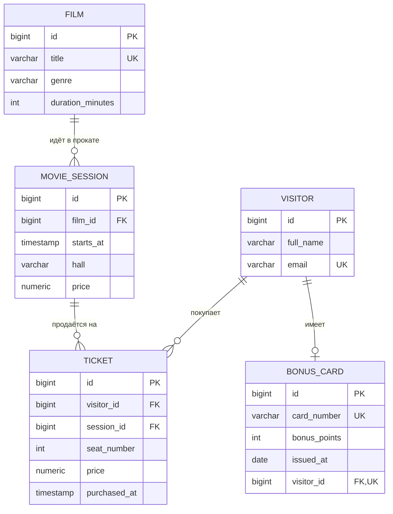

# Кинотеатр — ДЗ по базам данных

Spring Boot 3.5, Hibernate и PostgreSQL.

Фильмы, сеансы, билеты, посетители и бонусные карты.

## Модель данных

Пять сущностей и три типа связей из задания.

| Таблица | Сущность | Поля |
|---|---|---|
| `film` | `Film` | `id`, `title` (unique), `genre`, `duration_minutes` |
| `movie_session` | `Session` | `id`, `film_id` → `film`, `starts_at`, `hall`, `price` |
| `visitor` | `Visitor` | `id`, `full_name`, `email` (unique) |
| `bonus_card` | `BonusCard` | `id`, `card_number` (unique), `bonus_points`, `issued_at`, `visitor_id` (unique) → `visitor` |
| `ticket` | `Ticket` | `id`, `visitor_id` → `visitor`, `session_id` → `session`, `seat_number`, `price`, `purchased_at` |

Связи между таблицами:

Связь «один-ко-многим» между фильмом и сеансом держится на `Session.film` (`@ManyToOne` + `@JoinColumn(name = "film_id")`), обратная сторона в `Film.sessions` (`@OneToMany(mappedBy = "film")`).

Связь «многие-ко-многим» между посетителем и сеансом идёт через связующую сущность `Ticket`: две `@ManyToOne` и собственные атрибуты (место, цена, время покупки).

Связь «один-к-одному» между посетителем и бонусной картой: внешний ключ `visitor_id` с ограничением уникальности лежит в `bonus_card`, у `Visitor` обратная сторона `mappedBy = "visitor"`.



У билета есть уникальный составной ключ `(session_id, seat_number)`: на одно место
на один сеанс продаётся ровно один билет.

## Как запустить

Нужны Docker и JDK 17+. База поднимается одной командой из корня проекта:

```bash
docker compose up -d
```

Контейнер слушает порт 5433 на хосте, чтобы не спорить с локальным PostgreSQL на 5432.
Приложение по умолчанию подключается именно туда.

Затем:

```bash
mvn spring-boot:run
```

Приложение поднимется на `http://localhost:8080`. При первом запуске `DataInitializer`
заливает демонстрационные данные: 4 фильма, 5 сеансов на ближайшие дни, 3 посетителя
с бонусными картами и 5 билетов. Если фильмы в базе уже есть, сиды пропускаются,
поэтому перезапуск не плодит дубликаты.

Если база уже есть в другом месте, адрес и учётные данные переопределяются переменными:

```bash
DB_URL=jdbc:postgresql://localhost:5432/cinema DB_USERNAME=cinema DB_PASSWORD=cinema mvn spring-boot:run
```

В PowerShell те же переменные задаются по одной:

```powershell
$env:DB_URL="jdbc:postgresql://localhost:5432/cinema"
$env:DB_USERNAME="cinema"
$env:DB_PASSWORD="cinema"
mvn spring-boot:run
```

Схему создаёт Hibernate (`spring.jpa.hibernate.ddl-auto=update`), Flyway не подключён.
Задание это допускает.

Все запросы также лежат в `http/requests.http`, файл открывается в IntelliJ IDEA
и позволяет прогнать сценарии кнопкой.

## Сценарии проверки

Покупка билета. Сначала смотрим сеансы фильма:

```bash
curl "http://localhost:8080/api/sessions?filmId=1"
```

Затем покупаем билет. У Арины Шубиной на карте больше 100 баллов, поэтому сработает
скидка 10 %, а на покупку начислятся новые баллы:

```bash
curl -X POST http://localhost:8080/api/tickets \
  -H "Content-Type: application/json" \
  -d '{"visitorId":1,"sessionId":1,"seatNumber":10}'
```

Повторная покупка на то же место вернёт `409 Conflict`, на несуществующего посетителя
вернёт `404 Not Found` с телом `ProblemDetail`.

Динамический поиск: зал и максимальная цена, остальные фильтры не переданы,
поэтому в `where` попадут только эти два условия.

```bash
curl "http://localhost:8080/api/sessions/search?hall=%D0%97%D0%B0%D0%BB%201&maxPrice=430"
```

JPQL с `join fetch`: расписание за период подтягивает фильм тем же запросом.

```bash
curl "http://localhost:8080/api/sessions/schedule?from=2026-11-24T00:00:00&to=2026-12-31T23:59:59"
```

Нативный SQL: сколько билетов продано на сеанс.

```bash
curl "http://localhost:8080/api/tickets/sold?sessionId=1"
```

Регистрация посетителя вместе с бонусной картой:

```bash
curl -X POST http://localhost:8080/api/visitors \
  -H "Content-Type: application/json" \
  -d '{"fullName":"Пётр Сидоров","email":"petr.sidorov@example.com"}'
```

Нативный SQL по агрегату: сумма баллов по всем картам.

```bash
curl "http://localhost:8080/api/bonus-cards/total-points"
```

Проверка валидации: пустое тело даёт `400 Bad Request` и список ошибок по полям.

```bash
curl -X POST http://localhost:8080/api/films \
  -H "Content-Type: application/json" \
  -d '{"title":"","genre":"","durationMinutes":0}'
```

## Структура проекта

```
src/main/java/ru/urfu/cinema
├── CinemaApplication.java          точка входа
├── config/DataInitializer.java     сиды
├── domain/                         пять сущностей
├── repository/                     пять JpaRepository
├── service/                        бизнес-логика и @Transactional
└── web/                            контроллеры, DTO, обработка ошибок
src/main/resources/application.yml  подключение к БД
docker-compose.yml                  PostgreSQL
http/requests.http                  готовые запросы
```